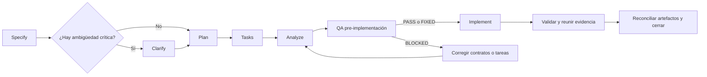

# Guía Operativa de Spec Kit para OneITB23

**Corte de revisión:** Noviembre 2026 (Actualización de Gobernanza Multi-Agente y Skills 6.2)
**Ámbito:** guía metodológica operativa para planificar, implementar y verificar cambios
mediante las skills de Spec Kit en el repositorio (`.agents/skills/`). No sustituye las
fuentes canónicas del proyecto ni forma parte de la entrega académica institucional.

---

## 1. Propósito

Spec Kit transforma una solicitud en artefactos verificables antes de modificar código.
Su objetivo no es generar documentación por volumen, sino reducir ambigüedad, controlar
riesgo y conservar trazabilidad entre requisito, diseño, tarea, implementación y evidencia.

El flujo se adapta al tamaño del cambio. Una corrección documental acotada no necesita el
mismo despliegue que una migración EF Core o un cambio de autorización. En todos los casos,
la evidencia debe ser proporcional al riesgo y ninguna casilla marcada reemplaza una prueba
runtime cuando el comportamiento depende del entorno.

## 2. Fuentes y precedencia

Antes de iniciar una spec, el agente debe leer:

1. `.specify/feature.json`, que apunta al directorio de feature activo;
2. los artefactos disponibles de esa feature;
3. `.specify/memory/constitution.md`;
4. `docs/project_docs/ROADMAP.md`;
5. el documento canónico responsable del contrato afectado.

La precedencia aplicable es:

1. código ejecutable, modelo EF, migraciones y schema runtime;
2. evidencia producida sobre el commit relevante;
3. Constitución;
4. Roadmap y contratos canónicos de alcance/arquitectura;
5. auditoría y runbook;
6. historial, resúmenes académicos, specs y paquetes derivados.

`core-web/` es contexto derivado para una IA externa. No es una fuente absoluta y debe
regenerarse cuando cambien contratos, métricas, arquitectura o riesgos canónicos. Los
mensajes de chat son instrucciones de trabajo, no evidencia persistente.

## 3. Cuándo crear una spec

Crear o actualizar una spec cuando el cambio afecte al menos uno de estos puntos:

- comportamiento observable o requisito funcional;
- GraphQL, autorización, sesión, privacidad o seguridad;
- entidades, relaciones, migraciones o datos persistidos;
- flujo React/Apollo compartido, realtime o caché;
- infraestructura, despliegue o integración externa;
- varios módulos o una superficie con riesgo de regresión;
- documentación canónica que cambie alcance, arquitectura o estado.

Una corrección tipográfica aislada, la actualización de una fecha confirmada o una
normalización local sin impacto contractual puede ejecutarse sin crear una spec nueva,
pero igualmente requiere revisión del diff y trazabilidad documental cuando corresponda.

Durante el Code Freeze solo se admite alcance nuevo con autorización explícita. Los fixes
deben ser mínimos, reproducibles y acompañados por una regresión proporcional.

## 4. Invocación de skills

Las skills instaladas viven en `.agents/skills/`. Se invocan desde el chat con su nombre;
según la interfaz puede usarse el prefijo `$` o `/`.

```text
$speckit-specify Describir de forma concreta el problema, los actores, el resultado esperado y las restricciones.
```

No es necesario inventar parámetros CLI. El texto que acompaña la invocación es la fuente
de entrada. Si el usuario exige una numeración específica, debe indicarla; de lo contrario,
`speckit-specify` resuelve el próximo directorio secuencial y actualiza
`.specify/feature.json`.

La feature señalada por `feature.json` puede estar ya cerrada. El puntero identifica el
contexto seleccionado, no demuestra que exista trabajo pendiente.

## 5. Flujo recomendado



### 5.1 Specify: definir qué y por qué

```text
$speckit-specify Implementar [resultado] para [actor], respetando [restricciones] y verificando [criterios].
```

Debe producir, como mínimo:

- `spec.md` con escenarios, requisitos y criterios medibles;
- `checklists/requirements.md` completo;
- un directorio único y el puntero actualizado en `.specify/feature.json`.

La especificación evita decisiones de implementación innecesarias. Debe dejar claros los
actores, permisos, datos, límites, errores y condiciones de éxito.

### 5.2 Clarify: resolver decisiones que cambian el alcance

```text
$speckit-clarify
```

Se usa antes del plan cuando existen alternativas con impacto material en seguridad,
alcance, persistencia o experiencia. No se utiliza para preguntar detalles que pueden
inferirse de la Constitución, el código o los contratos canónicos.

Resultado esperado: decisiones incorporadas en `spec.md`, sin marcadores abiertos que
impidan planificar de forma segura.

### 5.3 Plan: diseñar cómo

```text
$speckit-plan
```

El plan contrasta el cambio con la Constitución y la arquitectura existente. Según el
alcance puede generar:

- `plan.md`;
- `research.md`;
- `data-model.md`;
- `contracts/`;
- `quickstart.md`.

Debe explicar ownership, autorización, transacciones, compatibilidad, rollback,
observabilidad y estrategia de pruebas. No debe proponer una arquitectura paralela cuando
el repositorio ya ofrece un patrón válido.

### 5.4 Tasks: convertir el diseño en trabajo ejecutable

```text
$speckit-tasks
```

`tasks.md` debe incluir IDs únicos, dependencias, rutas concretas y orden seguro. El orden
normal es: baseline y pruebas, modelo/migración, backend, contratos GraphQL, frontend,
integración, QA, evidencia y documentación.

Las tareas paralelas solo se marcan como tales cuando no escriben los mismos archivos ni
dependen de resultados todavía inexistentes. Una tarea no se marca `[x]` por intención.

### 5.5 Checklist: agregar controles específicos

```text
$speckit-checklist seguridad, autorización, accesibilidad y rollback
```

Es útil para cambios de riesgo medio/alto o para criterios institucionales no cubiertos por
el checklist base. Una lista incompleta debe resolverse o quedar bloqueada explícitamente
antes de implementar.

### 5.6 Analyze: consistencia antes de tocar código

```text
$speckit-analyze
```

Compara `spec.md`, `plan.md` y `tasks.md` sin modificar código. Debe detectar requisitos
sin tarea, tareas sin requisito, contradicciones, ambigüedades y cobertura insuficiente.
Conviene repetirlo al cierre si la implementación obligó a cambiar contratos o tareas.

No analiza “commits finales” por sí mismo ni reemplaza tests, schema runtime o browser QA.

### 5.7 QA: gate de pre-implementación

```text
$speckit-qa
```

Clasifica el cambio como `LOW`, `MEDIUM` o `HIGH` y devuelve:

- `PASS`: puede implementarse;
- `FIXED`: se corrigieron artefactos/tareas y puede implementarse;
- `BLOCKED`: falta una decisión, baseline o control imprescindible.

Para riesgo alto debe revisar de manera dirigida autorización, migraciones, concurrencia,
N+1, caché Apollo, realtime, secretos y rollback. El objetivo es encontrar defectos antes
de escribir código, no ejecutar una auditoría exhaustiva innecesaria para cada cambio.

### 5.8 Implement: ejecutar tasks.md

```text
$speckit-implement
```

La implementación debe respetar dependencias, modificar solo el alcance acordado, agregar
pruebas antes o junto con el comportamiento y marcar tareas únicamente después de obtener
el resultado correspondiente. Si aparece un bloqueo, se registra; no se convierte en PASS
por reducir el criterio de aceptación.

Las instrucciones de Git de las skills son auxiliares. En OneITB23 no existen commits ni
push automáticos: solo se ejecutan cuando el usuario los solicita expresamente.

## 6. Skills especializadas

Estas skills complementan el plan o la implementación; no sustituyen el flujo principal:

| Skill | Uso recomendado |
|---|---|
| `speckit-db-perf` | Queries EF/GraphQL, índices, paginación, proyecciones y prevención de N+1 |
| `speckit-state-sync` | Mutaciones Apollo, cache, optimistic UI, logout y estado realtime |
| `speckit-error-boundary` | Fallos de red, integraciones, UI recuperable y logging estructurado |
| `speckit-constitution` | Solo para enmendar principios de gobierno y sincronizar artefactos dependientes |
| `speckit-taskstoissues` | Convertir tareas cerradas documentalmente en issues cuando el equipo lo requiera |
| skills `speckit-git-*` | Operaciones Git explícitas; nunca implican autorización automática para commit/push |

Las reglas especializadas se contrastan con el código actual. Si una recomendación genérica
choca con una decisión aceptada del proyecto, prevalecen Constitución y arquitectura.

## 7. Evidencia y estados

OneITB23 distingue:

- `[x] [I]`: implementado con evidencia de código, build, migración o prueba aislada;
- `[x] [V]`: ejecutado en runtime con el actor, entorno y contrato afectados;
- `[ ] [P]`: pendiente;
- `[ ] [B]`: bloqueado por una dependencia concreta.

Un cierre profesional registra:

- fecha y commit cuando exista;
- ambiente y configuración relevante sin secretos;
- comandos realmente ejecutados y su resultado;
- casos positivos y negativos;
- migración/model drift, si aplica;
- rol utilizado y rechazo de roles no autorizados;
- capturas o recorrido browser, si aplica;
- procesos/contenedores iniciados y limpieza posterior;
- checks omitidos y causa precisa.

Los baselines backend 183/183 y frontend 144/144 son cortes sucesivos. Deben repetirse
juntos sobre el SHA candidato antes de presentarlos como evidencia combinada de release.

## 8. Validación mínima por tipo de cambio

| Cambio | Validación mínima |
|---|---|
| Documentación | Enlaces, métricas, términos, fences/Mermaid y `git diff --check` |
| Frontend aislado | Tests focalizados, suite afectada y build Vite |
| Backend aislado | Tests focalizados, suite backend y build Release |
| GraphQL | Build, tests, schema runtime y operación permitida/denegada |
| EF Core | Tests, build, revisión de migración y `has-pending-model-changes` |
| Autorización/privacidad | Matriz de roles, ownership y casos negativos runtime |
| Apollo/sesión | Cache, logout A -> login B, transportes y no filtración de identidad |
| Realtime | Dos clientes aislados, reconexión, topics y no leídos |
| Infraestructura | Configuración, healthcheck, logs, smoke finito y cleanup |

Comandos base vigentes:

```powershell
dotnet build "API Graphql/OneITB/GraphQL.csproj" -c Release
dotnet test "API Graphql/Tests/Services.Tests/Services.Tests.csproj" -c Release --no-restore
dotnet ef migrations has-pending-model-changes --project "API Graphql/Data/Data.csproj" --startup-project "API Graphql/OneITB/GraphQL.csproj"
```

Desde `FrontEnd/OneItb-FE`:

```powershell
npm.cmd run test -- --run
npm.cmd run build
npm.cmd audit --omit=dev
```

No ejecutar `dotnet run` o `npm run dev` como supuesto test finito. Si un smoke requiere
servidor, debe iniciarse temporalmente con PID/log, comprobar readiness, ejecutar el caso,
detener solo ese proceso y documentar la limpieza. Si el usuario prohíbe levantar servidores,
la comprobación queda estática o bloqueada, nunca verificada por inferencia.

## 9. Cierre documental

Al completar una spec:

1. cerrar o bloquear explícitamente cada tarea;
2. completar `evidence.md` con resultados reales;
3. actualizar el Roadmap solo desde esa evidencia;
4. insertar una única entrada en `DEVELOPMENT_LOG.md`, arriba y en cronología inversa;
5. actualizar `DOCUMENTATION_STATUS.md` si cambió un documento o estado canónico;
6. propagar cambios de contrato a scope, arquitectura, runbook, auditoría, resúmenes y
   memoria final según su responsabilidad;
7. repetir `speckit-analyze` cuando los artefactos hayan cambiado durante la ejecución;
8. inspeccionar el diff y declarar con precisión lo que no se validó.

El Roadmap es la única fuente de avance. El Development Log es histórico. Las specs son
evidencia granular y no deben utilizarse como un roadmap paralelo.

## 10. Definition of Done

Una spec está cerrada cuando:

- el alcance acordado está implementado sin placeholders;
- requisitos, contratos y tareas conservan trazabilidad;
- los checklists requeridos están completos;
- las tareas terminadas están marcadas y los bloqueos permanecen visibles;
- pruebas, builds y controles proporcionales al riesgo pasaron;
- schema, persistencia, autorización, navegador o integración fueron ejecutados cuando
  correspondía y el entorno lo permitió;
- no quedaron procesos temporales ni recursos de prueba sin limpiar;
- documentación y evidencia coinciden con el resultado;
- `git diff --check` no reporta errores;
- el cierre no usa “verificado”, “producción” o “cero deuda” más allá de la evidencia.

## 11. Antipatrones a evitar

- Crear una mega-spec sin dependencias ni entregas verificables.
- Empezar a implementar con requisitos críticos ambiguos.
- Marcar todas las tareas al final sin evidencia por fase.
- Confundir build exitoso con operación GraphQL o flujo browser válido.
- Relajar CORS, autorización, CSP, rate limiting o certificados para ocultar un error.
- Agregar secretos, credenciales demo o archivos `.env` al repositorio.
- Ejecutar servidores bloqueantes sin control de PID y cleanup.
- Reescribir porcentajes del Roadmap desde una spec individual.
- Tratar `core-web`, el Development Log o un chat como fuente canónica.
- Hacer commit o push sin solicitud explícita y sin revisar el staging.

## 12. Plantillas breves de solicitud

### Feature o refactor

```text
$speckit-specify
Objetivo: [resultado observable].
Actores y permisos: [roles].
Alcance: [incluye].
Fuera de alcance: [excluye].
Restricciones: [seguridad, datos, UX, Git].
Aceptación: [casos positivos, negativos y evidencia esperada].
```

### Bug reproducible

```text
$speckit-specify
Problema: [mensaje y flujo exacto].
Precondiciones: [rol, ruta, datos, ambiente].
Resultado actual: [qué falla].
Resultado esperado: [contrato correcto].
Restricciones: [qué no debe cambiarse].
Definition of Done: regresión automatizada, build y validación del flujo afectado.
```

### Auditoría sin implementación

```text
$speckit-analyze
Auditar [artefactos o spec] sin modificar código. Priorizar inconsistencias, seguridad,
autorización, persistencia, rendimiento, pruebas faltantes y afirmaciones sin evidencia.
```

---

**Regla final:** Spec Kit mejora la calidad cuando obliga a decidir y verificar. Si solo
produce archivos extensos sin reducir incertidumbre ni aportar evidencia, el flujo debe
simplificarse, no ampliarse.
