# 4. Diagramas de diseño

| Dato de control | Valor |
|---|---|
| **Sistema** | OneITB23 |
| **Versión documental** | 2.1 |
| **Fecha de revisión** | 5 de agosto de 2026 |
| **Clasificación** | Vistas arquitectónicas derivadas |
| **Notación** | Mermaid; DER con cardinalidad Crow's Foot |
| **Fuente normativa** | [`architecture-and-design.md`](../project_docs/architecture-and-design.md) y modelo EF Core |

Los diagramas resumen el corte arquitectónico actual y están preparados para exportarse
con tema claro. No reemplazan el modelo EF Core, las migraciones ni los contratos
ejecutados. Los diagramas de flujo fuerzan líneas rectas u ortogonales para mejorar su
lectura impresa; los DER se dividen por subdominio para evitar una única lámina ilegible.

---

## 4.1 Índice y estrategia de exportación

| Figura | Vista | Uso recomendado |
|---:|---|---|
| 1 | Contexto del sistema | Presentación y memoria técnica |
| 2 | Componentes lógicos | Explicación arquitectónica |
| 3 | DER de identidad, perfil y catálogo | Anexo de datos |
| 4 | DER social, mensajería y moderación | Anexo de datos |
| 5 | DER académico, empleabilidad y auditoría | Anexo de datos |
| 6 | Autenticación Microsoft Entra | Seguridad e identidad |
| 7 | Publicación multimedia desacoplada | Contrato REST + GraphQL |
| 8 | Sincronización SIU mock | Patrón Adapter |
| 9 | Onboarding empresarial | B2B, transacción y Outbox |
| 10 | Notificaciones Pub/Sub | Tiempo real y escalabilidad |
| 11 | Despliegue local/aceptación | Reproducibilidad de demo |
| 12 | Plantilla productiva | Evolución cloud |
| 13 | Rebaseline de base demo | Operación y recuperación |

Para la entrega se recomienda exportar las figuras 1, 2, 6, 9, 10, 11 y 12 como SVG. Los
tres DER deben recrearse o ajustarse en diagrams.net si la exportación Mermaid no permite
controlar el enrutamiento Crow's Foot y el tamaño tipográfico requerido por la impresión.
Estas 13 vistas forman un paquete técnico complementario y no coinciden uno a uno con las
10 figuras principales enumeradas en `GUIA_MAQUETACION_FINAL.md`; las vistas adicionales
se incorporan al Word únicamente como anexos citados y después de revisar su legibilidad.

## 4.2 Figura 1 - Contexto del sistema

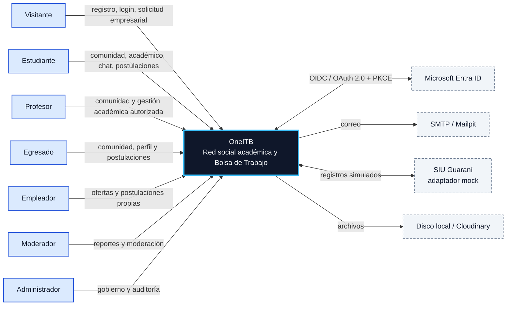

**Lectura.** OneITB constituye la frontera central. Los siete actores interactúan con
capacidades diferentes y toda autorización se resuelve dentro de la API. Entra, correo,
SIU y almacenamiento son sistemas externos o adaptadores; el gráfico no implica que sus
proveedores productivos estén aceptados.

**Recomendación A4.** Orientación horizontal (Landscape). Inserción recomendada en cuerpo principal. Exportable directamente desde Mermaid o recreable en diagrams.net. Mantener tipografía mínima equivalente a 10 pt. Riesgo muy bajo de saturación visual.

## 4.3 Figura 2 - Componentes lógicos

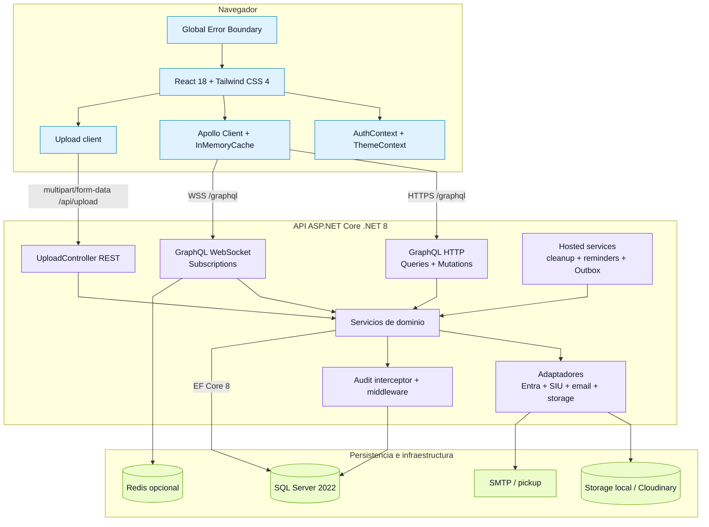

**Lectura.** GraphQL transporta negocio; `POST /api/upload` es la excepción binaria
autenticada. Apollo separa HTTP y WebSocket. Los servicios de dominio concentran
autorización y reglas, mientras EF Core persiste y el interceptor registra cambios
críticos. Redis, Cloudinary y SMTP se seleccionan por ambiente.

**Recomendación A4.** Orientación vertical (Portrait). Inserción recomendada en cuerpo principal. Exportable directamente desde Mermaid. Mantener tipografía mínima equivalente a 10 pt. Riesgo bajo de saturación visual.

## 4.4 Modelo de dominio relacional

En el corte post-Spec 220, `OneItbContext` expone **39 DbSet** y el inventario
GOB-11 registra **67 relaciones FK**. Para maquetar la versión actual usar los
DER de [identidad, perfil y catálogo](diagrams/03-der-identidad-perfil-catalogo.mmd),
[muro, mensajería y moderación](diagrams/04-der-social-mensajeria-moderacion.mmd)
y [académico, empleo y auditoría](diagrams/05-der-academico-empleo-auditoria.mmd).
El [inventario GOB-11](diagrams/GOB-20261109-11-entrega.md) distingue entidades
propias de referencias repetidas. Las figuras 3 a 5 reproducidas abajo documentan
el modelo anterior de 30 conjuntos; para imprimir se toman las fuentes enlazadas.

### Figura 3 - DER de identidad, perfil y catálogo académico

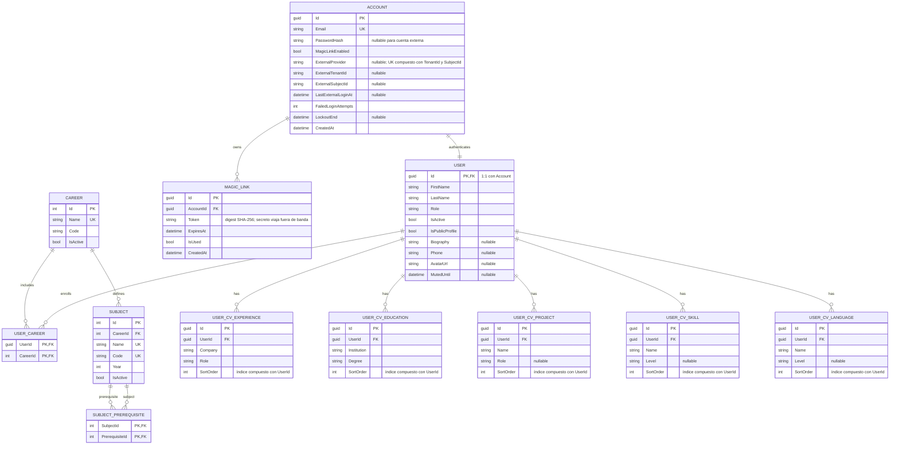

**Reglas destacadas.** `Account`-`User` es uno a uno (la PK de `Users` es FK a `Accounts.Id`);
`Account` no tiene `IsActive` propio (la activación reside en `User.IsActive`).
La identidad Microsoft se almacena en tres campos nullable con índice único compuesto filtrado sobre
`ExternalProvider+ExternalTenantId+ExternalSubjectId`. `MagicLinkEnabled` controla si el flujo sin
contraseña está activo para la cuenta. `UserCareer` y `SubjectPrerequisite` poseen claves compuestas.
Las secciones del CV son entidades normalizadas, ordenables y con campos descriptivos mínimos; no se
persisten como JSON o LocalStorage. `Career.Name`, `Subject.Name` y `Subject.Code` tienen índices
únicos; `Career.Code` existe como propiedad pero no posee índice único en la configuración EF ni en el
snapshot actual. `Token` de `MagicLink` persiste el digest SHA-256, sin índice único. El DER es una
vista estructural resumida; el modelo EF/migraciones constituye el diccionario completo.

**Recomendación A4.** Orientación horizontal (Landscape). Destino recomendado: Anexo de datos. Recreación sugerida en diagrams.net para control de conectores Crow's Foot ortogonales. Mantener tipografía mínima equivalente a 10 pt. Riesgo medio de saturación por 12 entidades.

### Figura 4 - DER social, mensajería y moderación

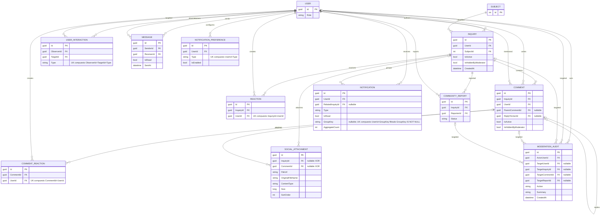

**Reglas destacadas.** Inquiry y Comment utilizan soft delete y ocultamiento moderado
separados. `Reaction` es única por `InquiryId+UserId`; `CommentReaction` por `CommentId+UserId`;
`UserInteraction` por `ObserverId+TargetId+Type`; `NotificationPreference` por `UserId+Type`;
`Notification` tiene UK compuesto `UserId+GroupKey` filtrado donde `GroupKey IS NOT NULL` (GroupKey
es nullable). `SocialAttachment` exige XOR: pertenece a una Inquiry o a un Comment, nunca a ambos ni
a ninguno. El nivel lógico de respuestas se limita a dos aunque la FK sea autorreferencial. Mensajes
tienen dos FKs restrictivas a User. `CommunityReport` tiene índice único parcial sobre
`InquiryId+ReporterId+Status` con filtro `[Status] = 'Pending'`: la unicidad solo aplica a reportes
pendientes, no a todos los estados.

**Recomendación A4.** Orientación horizontal (Landscape). Destino recomendado: Anexo de datos. Recreación sugerida en diagrams.net para evitar superposición de conectores. Mantener tipografía mínima equivalente a 10 pt. Riesgo alto de saturación por 13 entidades; mantener estrictamente separado de las otras vistas DER.

### Figura 5 - DER académico, empleabilidad, onboarding y auditoría

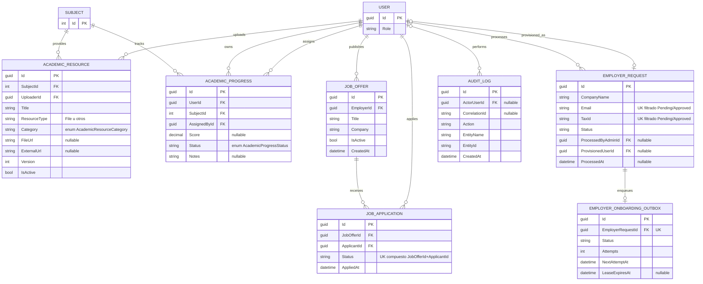

**Reglas destacadas.** `AcademicProgress` tiene UK compuesto `UserId+SubjectId` (no sobre `Score`)
y conserva al asignador; `Score` es `decimal?` nullable. `AcademicResource` omite `Description`
(nullable) por brevedad del DER. `JobApplication` es única por `JobOfferId+ApplicantId`.
La aprobación empresarial vincula opcionalmente procesador y usuario aprovisionado; el
`EmployerOnboardingOutbox` tiene índice único sobre `EmployerRequestId`. `AuditLog` acepta actor nulo
para procesos técnicos, pero nunca secretos. `EmployerRequest.TaxId` y `Email` son únicos con filtro
`[Status] IN ('Pending','Approved')`. El DER es una vista estructural resumida; el modelo
EF/migraciones constituye el diccionario completo.

**Recomendación A4.** Orientación horizontal (Landscape). Destino recomendado: Anexo de datos. Recreación sugerida en diagrams.net. Mantener tipografía mínima equivalente a 10 pt. Riesgo medio de saturación visual por 9 entidades.

## 4.5 Secuencias críticas

### Figura 6 - Autenticación Microsoft Entra por redirect

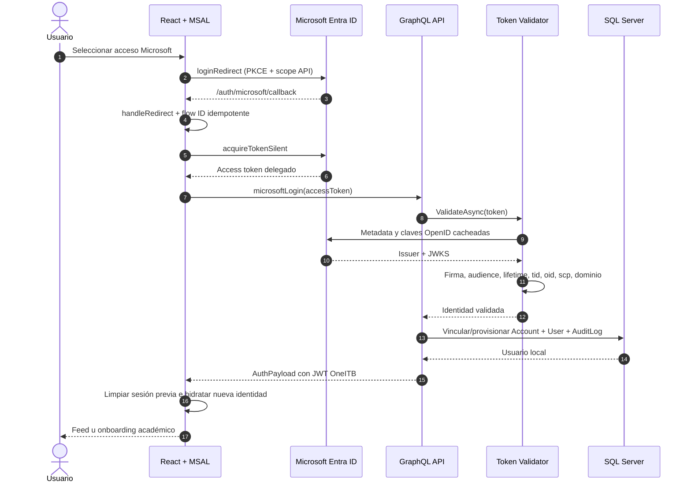

**Seguridad.** La autoridad `common` admite directorios organizacionales, pero la API
valida el tenant concreto del token. El access token externo no sustituye el JWT local.
Múltiples cuentas ambiguas o configuración incompleta fallan de forma cerrada.

**Recomendación A4.** Orientación vertical (Portrait). Inserción recomendada en cuerpo principal o anexo de seguridad. Exportable directamente desde Mermaid. Mantener tipografía mínima equivalente a 10 pt. Riesgo bajo de saturación.

### Figura 7 - Publicación multimedia con carga desacoplada

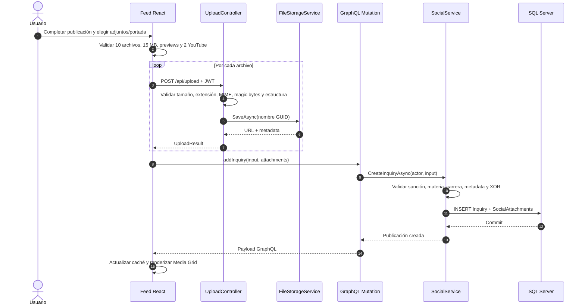

**Frontera.** El upload físico no crea por sí solo una publicación. Los archivos quedan
referenciados recién al completar GraphQL; un worker limpia uploads huérfanos. La entrega
estática por recurso permanece como `GAP-FILE-01`.

**Recomendación A4.** Orientación vertical (Portrait). Inserción recomendada en anexo técnico. Exportable directamente desde Mermaid. Mantener tipografía mínima equivalente a 10 pt. Riesgo bajo de saturación.

### Figura 8 - Sincronización académica mediante SIU mock

```mermaid
%%{init: {"theme": "default"}}%%
sequenceDiagram
    autonumber
    actor A as Administrador
    participant FE as AcademicDashboard
    participant GQL as GraphQL Mutation
    participant S as AcademicService
    participant SIU as ISiuIntegrationService (Mock)
    participant DB as SQL Server
    participant N as NotificationService

    A->>FE: Sincronizar materia
    FE->>GQL: syncSiuGrades(subjectId)
    GQL->>S: SyncSiuGradesAsync(actor, subjectId)
    S->>S: Validar rol y materia
    S->>SIU: GetGradesAsync(subjectId)
    SIU-->>S: Registros simulados
    loop Cada registro
        S->>S: Validar identidad, nota 0-10 y estado
        alt Registro válido
            S->>DB: Upsert AcademicProgress
        else Registro inválido
            S->>S: Agregar skipped item
        end
    end
    S->>DB: SaveChangesAsync + AuditLog
    S->>N: Crear notificaciones académicas
    N->>DB: INSERT Notifications
    S-->>GQL: SiuSyncResult
    GQL-->>FE: Totales, actualizados y omitidos
```

**Límite.** El adaptador demuestra desacoplamiento y upsert; no representa una conexión
real ni procesa información del SIU institucional.

**Recomendación A4.** Orientación vertical (Portrait). Inserción recomendada en anexo técnico. Exportable directamente desde Mermaid. Mantener tipografía mínima equivalente a 10 pt. Riesgo bajo de saturación.

### Figura 9 - Solicitud, aprobación y bienvenida de empleador

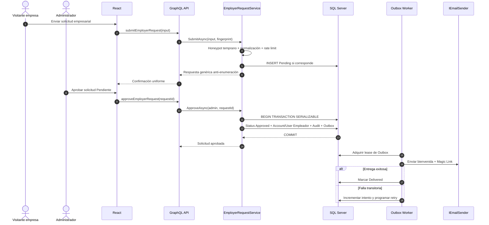

**Seguridad y consistencia.** El rol aprovisionado es siempre Empleador. La transacción
evita estados parciales y el Outbox impide que una falla SMTP deshaga la cuenta o genere
duplicados. El rechazo registra acción sin copiar el motivo sensible al audit transversal.

**Recomendación A4.** Orientación vertical (Portrait). Inserción recomendada en cuerpo principal (sección B2B). Exportable directamente desde Mermaid. Mantener tipografía mínima equivalente a 10 pt. Riesgo medio de saturación por secuencia en dos fases.

## 4.6 Figura 10 - Notificaciones y mensajes en tiempo real

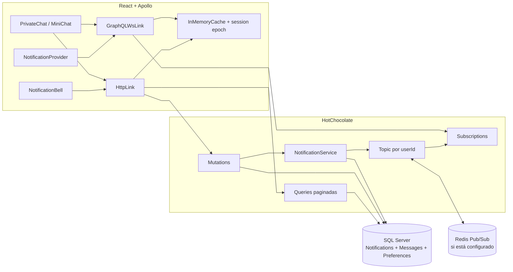

**Lectura.** El evento realtime no reemplaza la persistencia. Queries recuperan estado y
badges desde registros no leídos; subscriptions aceleran la UI. Los topics se derivan de
la identidad autenticada. En memoria sirve una instancia; Redis permite distribución
entre réplicas. Logout cierra el socket y descarta respuestas de una época anterior.

**Recomendación A4.** Orientación horizontal (Landscape). Inserción recomendada en cuerpo principal. Exportable directamente desde Mermaid. Mantener tipografía mínima equivalente a 10 pt. Riesgo bajo de saturación visual.

## 4.7 Despliegue y operación

### Figura 11 - Entorno local y de aceptación

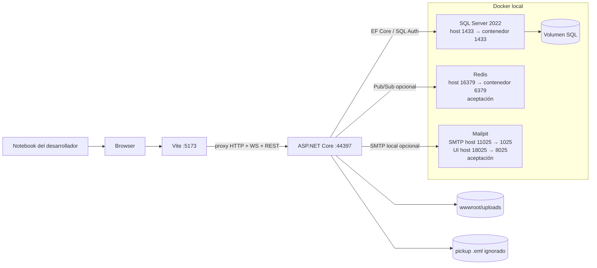

**Lectura.** SQL Server Docker es la base local canónica. Redis y Mailpit se agregan en
aceptación sin reemplazar SQL. Vite conserva origen simple mediante proxy. Secretos y
archivos generados permanecen fuera de Git.

**Recomendación A4.** Orientación horizontal (Landscape). Inserción recomendada en cuerpo principal. Exportable directamente desde Mermaid. Mantener tipografía mínima equivalente a 10 pt. Riesgo bajo de saturación visual.

### Figura 12 - Plantilla de despliegue productivo

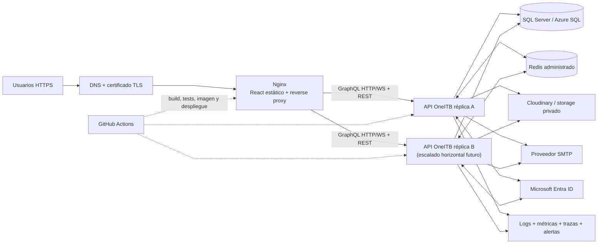

**Límite de esta vista.** Es una arquitectura objetivo, no el `docker-compose.prod.yml` ejecutado.
El compose de producción actual declara un solo servicio `oneitb-api` (expose 8080, sin port mapping
al host) y un `oneitb-web` con Nginx embebido (host 80→contenedor 80, escucha HTTP); las réplicas A/B
representan una escala horizontal futura. El Nginx incluido no termina TLS (solo escucha puerto 80);
la terminación TLS se muestra como externa (`DNS + certificado TLS`). El destino requiere certificado
SQL verificable (`TrustServerCertificate=False`), SMTP real, Redis administrado, storage privado,
observabilidad, backup/restore, rotación de secretos y respuesta a incidentes (`GAP-INFRA-01`, `GAP-OPS-01`).

**Recomendación A4.** Orientación horizontal (Landscape). Inserción recomendada en cuerpo principal. Exportable directamente desde Mermaid o recreable en diagrams.net. Mantener tipografía mínima equivalente a 10 pt. Riesgo medio de saturación.

### Figura 13 - Rebaseline y aceptación de la base demo

```mermaid
%%{init: {"theme": "default", "flowchart": {"curve": "linear"}}}%%
flowchart LR
    GUARD["Validar contenedor, puerto, DB y secretos"] --> BUILD["Build Release + EF sin drift"]
    BUILD --> BACKUP["BACKUP COPY_ONLY + CHECKSUM"]
    BACKUP --> VERIFY["RESTORE VERIFYONLY"]
    VERIFY --> DROP["Eliminar solo OneItb"]
    DROP --> MIGRATE["Aplicar migraciones EF Core"]
    MIGRATE --> SEED1["Seed canónico por fases"]
    SEED1 --> CLEAR1["SaveChanges + ChangeTracker.Clear"]
    CLEAR1 --> SNAP1["Inventario 1"]
    SNAP1 --> SEED2["Segunda ejecución idempotente"]
    SEED2 --> SNAP2["Inventario 2"]
    SNAP2 --> SAME{"Inventarios idénticos"}
    SAME -->|"No"| RESTORE["Abortar y restaurar backup"]
    SAME -->|"Sí"| INTEGRITY["Integridad relacional = 0"]
    INTEGRITY --> ROLES["Login de 6 roles"]
    ROLES --> SMOKE["Smoke GraphQL + upload"]
    SMOKE --> DONE["Base demo aceptada"]
```

**Seguridad operativa.** El procedimiento se limita al contenedor y base canónicos,
requiere confirmación destructiva y conserva backup fuera de Git. Las migraciones crean
el esquema; el seeder aporta únicamente datos y debe producir el mismo inventario en una
segunda ejecución.

**Recomendación A4.** Orientación horizontal (Landscape). Inserción recomendada en anexo operativo / Runbook. Exportable directamente desde Mermaid. Mantener tipografía mínima equivalente a 10 pt. Riesgo medio de saturación por flujo lineal de 14 pasos.

## 4.8 Reglas de consistencia y mantenimiento

1. Un cambio de entidad o FK obliga a actualizar las figuras 3, 4 o 5 después de aplicar
   la migración correspondiente.
2. Un cambio de transporte, provider o middleware obliga a revisar figuras 1, 2, 10, 11
   y 12.
3. Los diagramas de secuencia deben usar nombres reales de contratos y no convertir una
   intención futura en comportamiento vigente.
4. Las líneas de asociación en DER indican cardinalidad, no orden de ejecución.
5. Los componentes externos con aceptación pendiente deben conservar estilo diferenciado
   o una nota de límite.
6. Ningún diagrama debe incluir passwords, tokens, connection strings, CUIT reales o PII.
7. Antes de imprimir, cada SVG debe comprobarse al 100 % de zoom y en escala de grises.
8. La memoria final puede reutilizar estas vistas, pero debe numerarlas como figuras y
   mantener título, fuente y descripción accesible.

## 4.9 Correspondencia con fuentes

| Vista | Fuentes de contraste |
|---|---|
| Contexto y componentes | `Startup.cs`, frontend providers, arquitectura secciones 2-5 |
| DER | `OneItbContext.cs`, 39 `DbSet`, 67 FK del inventario GOB-11 y migraciones post-Spec 220 |
| Entra | `MicrosoftEntraOptions`, validator, auth service y callback React |
| Multimedia | `UploadController`, storage service, social service y Media Grid |
| SIU | `ISiuIntegrationService`, mock y `AcademicService` |
| B2B | `EmployerRequestService`, entidades de request/Outbox y worker |
| Pub/Sub | configuración HotChocolate, `NotificationService`, Apollo WS y Redis |
| Despliegue | Dockerfiles, Compose local/acceptance/productivo, Nginx y Runbook |
| Rebaseline | script de rebaseline, seeder, migraciones y evidencia de Spec 196 |

La fuente de verdad continúa siendo el código ejecutado. Si una figura contradice una
migración o un contrato runtime, debe corregirse la figura y registrar la desviación; no
se modifica el sistema para hacerlo coincidir con una representación desactualizada.
