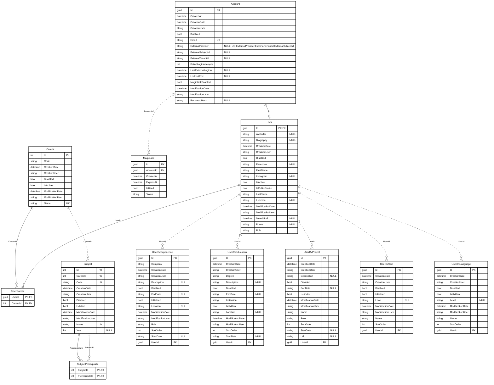
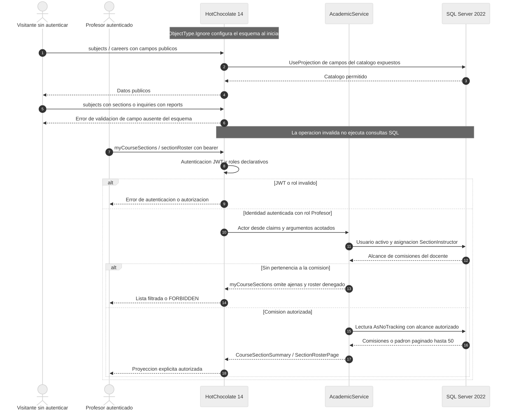

# GOB-20261109-11 · DER y auditoría editorial

Fecha: 9 de noviembre de 2026 (America/Buenos_Aires). Rama `feature/2026-11-01-debugger-cv-builder`, SHA `62338cbd60766cf5cbe48b505cf06f57daa32a5e`. Spec activa: `specs/220-core-closure-and-application-hardening`.

**Entrega de consultoría lista para integrar por Local AGY.** No se alteró código productivo ni el DOCX. El framework, sección 5.3, establece: «La estación local (Orquestador) es el único escritor autorizado en el repositorio». Se preservaron el prompt modificado y los archivos de defensa preexistentes. Las cifras 281 Vitest y 264 xUnit son la baseline comunicada y recogida en el roadmap; no se reejecutaron aquí.

## 1. Contraste y correcciones

El `OneItbContext` y el snapshot tienen **39 entidades persistidas y 67 relaciones FK**. Las tres figuras cubren las 39 sin contar dos veces las referencias. Se incluyen todos los campos persistidos de las entidades propias, incluso los heredados de EntityModel; las referencias externas al subdominio muestran solo su PK. `modelo-ef.json` conserva el diccionario SQL, nulabilidad, claves, índices y relaciones. Los tipos Mermaid son tipos lógicos: guid = uniqueidentifier, datetime = datetime2, bool = bit, long = bigint, bytes RowVersion = rowversion SQL; los enums persistidos como varchar se muestran como string. La longitud SQL exacta está en el diccionario.

- `JobApplication ||--o| JobApplicationCv`: uno a uno con captura opcional desde la postulación; ApplicationId es PK/FK. Las postulaciones antiguas pueden carecer de captura. El JSON cumple ISJSON y es una captura histórica, no el CV vivo.
- `Comment o|..o{ CommunityReport`: FK compuesta `(CommentId, InquiryId)` hacia AK `(Id, InquiryId)`. InquiryId siempre referencia Inquiry. CommentId nulo identifica denuncia de publicación. Pendientes únicos por `(ReporterId, InquiryId)` cuando CommentId es NULL, o `(ReporterId, CommentId)` cuando es NOT NULL; Status debe ser Pending en ambos filtros.
- `SectionEnrollment ||..o| SectionGrade`: FK `(SectionId, StudentId)` al padrón, con índice único. Además existen FKs directas de la nota a CourseSection, Student y AssignedBy. RowVersion es generado por SQL, no fecha ni versión editable. La actualización requiere ExpectedVersion.
- `PrivateUpload ||..o| MessageAttachment`: UploadId es FK e índice único. Una carga libre aún no tiene adjunto. Un mensaje puede tener cero adjuntos; el máximo cuatro se valida en el servicio, no se infiere de una FK.
- `EnrollmentStanding ||..o{ RegularStudentCertificate`: StandingId NO es único. La reusabilidad del certificado se decide en el servicio; no debe dibujarse un 1:1 inexistente.
- `Account ||--o| User`: la FK única compartida obliga a cada User a tener una Account, pero SQL no obliga a cada Account a tener un User. La aplicación aprovisiona ambos. Cascade se conserva solo como excepción de este agregado; el resto de relaciones observadas usa Restrict.
- `User o|..o{ EmployerRequest` por ProvisionedUserId: el índice no es único. Se corrige el 1:1 previo que el esquema no garantiza.

Convención Crow's Foot: `||` exactamente uno, `o|` cero o uno, `o{` cero o muchos; `--` relación identificadora (FK contenida en PK), `..` relación no identificadora. Las etiquetas se entrecomillan. PK/FK/UK no expresa por sí solo la composición o filtro de un índice: se aclara en comentarios y en estas notas. Sintaxis de referencia: [Mermaid ER oficial](https://mermaid.js.org/syntax/entityRelationshipDiagram.html).

## 2. Bloques Mermaid completos para reemplazar las figuras técnicas 3, 4 y 5

Las tres vistas maestras son inventario exhaustivo digital. **No reducirlas a una sola página A4**: usar los paneles de impresión incluidos, conservar referencias y citar el diccionario. Un render correcto no demuestra legibilidad A4. Consultar `validacion.json` para resultados reales de render y tamaño efectivo.

### Figura técnica 3 · Identidad, perfil y catálogo



### Figura técnica 4 · Social, mensajería y moderación

```mermaid
%%{init: {"theme":"base","themeVariables":{"fontFamily":"Arial","fontSize":"16px","primaryColor":"#ffffff","primaryTextColor":"#000000","primaryBorderColor":"#000000","lineColor":"#000000","secondaryColor":"#ffffff","tertiaryColor":"#ffffff"},"er":{"layoutDirection":"TB","minEntityWidth":100,"entityPadding":12}}}%%
erDiagram
    User {
        guid Id PK,FK
    }
    Subject {
        int Id PK
    }
    Inquiry {
        guid Id PK
        string Content
        datetime CreationDate
        string CreationUser
        bool Disabled
        string FileUrl "NULL"
        bool IsActive
        bool IsHiddenByModerator
        datetime ModificationDate
        string ModificationUser
        bool PreferAttachmentCover
        datetime PublishDate
        int SubjectId FK
        string Title
        datetime UpdatedAt "NULL"
        guid UserId FK
    }
    Comment {
        guid Id PK "AK Id,InquiryId"
        string Content
        datetime CreatedAt
        string FileUrl "NULL"
        guid InquiryId FK
        bool IsActive
        bool IsHiddenByModerator
        guid ParentCommentId FK "NULL"
        guid ReplyToUserId FK "NULL"
        datetime UpdatedAt "NULL"
        guid UserId FK
    }
    Reaction {
        guid Id PK
        datetime CreatedAt
        guid InquiryId FK "UQ InquiryId,UserId"
        guid UserId FK
    }
    CommentReaction {
        guid Id PK
        guid CommentId FK "UQ CommentId,UserId"
        datetime CreatedAt
        guid UserId FK
    }
    SocialAttachment {
        guid Id PK
        guid CommentId FK "NULL"
        string ContentType
        datetime CreatedAt
        string FileUrl
        guid InquiryId FK "NULL"
        string OriginalFileName
        long Size
        int SortOrder
    }
    CommunityReport {
        guid Id PK
        guid CommentId FK "NULL; FK CommentId,InquiryId"
        datetime CreatedAt
        guid InquiryId FK "FK CommentId,InquiryId"
        string Reason
        guid ReporterId FK "UQ ReporterId,CommentId; UQ ReporterId,InquiryId"
        string Status
    }
    UserInteraction {
        guid Id PK
        datetime CreatedAt
        datetime CreationDate
        string CreationUser
        bool Disabled
        datetime ModificationDate
        string ModificationUser
        guid ObserverId FK "UQ ObserverId,TargetId,Type"
        guid TargetId FK
        string Type
    }
    Message {
        guid Id PK
        guid ClientMessageId "NULL"
        string Content "NULL"
        bool IsRead
        guid ReceiverId FK
        guid SenderId FK "UQ SenderId,ClientMessageId"
        datetime SentAt
    }
    PrivateUpload {
        guid Id PK
        long ByteSize
        string ContentType
        datetime CreatedAtUtc
        datetime ExpiresAtUtc
        string FileName
        bool IsConsumed
        guid OwnerId FK
        string StorageKey
    }
    MessageAttachment {
        guid Id PK
        long ByteSize
        string ContentType
        string FileName
        guid MessageId FK
        int OrderIndex
        guid UploadId FK,UK
    }
    Notification {
        guid Id PK
        string ActionUrl "NULL"
        int AggregateCount
        datetime CreatedAt
        datetime CreationDate
        string CreationUser
        bool Disabled
        string GroupKey "NULL"
        bool IsRead
        string Message
        datetime ModificationDate
        string ModificationUser
        guid RelatedInquiryId FK "NULL"
        bytes RowVersion "SQL rowversion"
        string Type
        datetime UpdatedAt "NULL"
        guid UserId FK "UQ UserId,GroupKey"
    }
    NotificationPreference {
        guid Id PK
        datetime CreationDate
        string CreationUser
        bool Disabled
        bool IsEnabled
        datetime ModificationDate
        string ModificationUser
        string Type
        datetime UpdatedAt
        guid UserId FK "UQ UserId,Type"
    }
    ModerationAudit {
        guid Id PK
        string Action
        guid ActorUserId FK
        datetime CreatedAt
        string Summary
        guid TargetCommentId FK "NULL"
        guid TargetInquiryId FK "NULL"
        guid TargetReportId FK "NULL"
        guid TargetUserId FK "NULL"
    }

    Subject ||..o{ Inquiry : "SubjectId"
    User ||..o{ Inquiry : "UserId"
    Inquiry ||..o{ Comment : "InquiryId"
    Comment o|..o{ Comment : "ParentCommentId"
    User o|..o{ Comment : "ReplyToUserId"
    User ||..o{ Comment : "UserId"
    Inquiry ||..o{ Reaction : "InquiryId"
    User ||..o{ Reaction : "UserId"
    Comment ||..o{ CommentReaction : "CommentId"
    User ||..o{ CommentReaction : "UserId"
    Comment o|..o{ SocialAttachment : "CommentId"
    Inquiry o|..o{ SocialAttachment : "InquiryId"
    Inquiry ||..o{ CommunityReport : "InquiryId"
    User ||..o{ CommunityReport : "ReporterId"
    Comment o|..o{ CommunityReport : "CommentId,InquiryId"
    User ||..o{ UserInteraction : "ObserverId"
    User ||..o{ UserInteraction : "TargetId"
    User ||..o{ Message : "ReceiverId"
    User ||..o{ Message : "SenderId"
    User ||..o{ PrivateUpload : "OwnerId"
    Message ||..o{ MessageAttachment : "MessageId"
    PrivateUpload ||..o| MessageAttachment : "UploadId"
    Inquiry o|..o{ Notification : "RelatedInquiryId"
    User ||..o{ Notification : "UserId"
    User ||..o{ NotificationPreference : "UserId"
    User ||..o{ ModerationAudit : "ActorUserId"
    Comment o|..o{ ModerationAudit : "TargetCommentId"
    Inquiry o|..o{ ModerationAudit : "TargetInquiryId"
    CommunityReport o|..o{ ModerationAudit : "TargetReportId"
    User o|..o{ ModerationAudit : "TargetUserId"
```



### Figura técnica 5 · Académico, empleo y auditoría

```mermaid
%%{init: {"theme":"base","themeVariables":{"fontFamily":"Arial","fontSize":"16px","primaryColor":"#ffffff","primaryTextColor":"#000000","primaryBorderColor":"#000000","lineColor":"#000000","secondaryColor":"#ffffff","tertiaryColor":"#ffffff"},"er":{"layoutDirection":"TB","minEntityWidth":100,"entityPadding":12}}}%%
erDiagram
    User {
        guid Id PK,FK
    }
    Subject {
        int Id PK
    }
    Career {
        int Id PK
    }
    AcademicResource {
        guid Id PK
        string Category
        datetime CreatedAt
        datetime CreationDate
        string CreationUser
        string Description "NULL"
        bool Disabled
        string ExternalUrl "NULL"
        string FileUrl "NULL"
        bool IsActive
        datetime ModificationDate
        string ModificationUser
        string ResourceType
        int SubjectId FK
        string Title
        datetime UpdatedAt "NULL"
        guid UploaderId FK
        int Version
    }
    AcademicProgress {
        guid Id PK
        guid AssignedById FK
        datetime CreationDate
        string CreationUser
        bool Disabled
        datetime ModificationDate
        string ModificationUser
        string Notes "NULL"
        decimal Score "NULL; decimal(5,2)"
        string Status
        int SubjectId FK
        datetime UpdatedAt
        guid UserId FK "UQ UserId,SubjectId"
    }
    CourseSection {
        guid Id PK
        string Code
        datetime CreatedAtUtc
        int SubjectId FK "UQ SubjectId,Term,Code"
        string Term
    }
    SectionInstructor {
        guid SectionId PK,FK
        guid ProfessorId PK,FK
        datetime AssignedAtUtc
    }
    SectionEnrollment {
        guid SectionId PK,FK
        guid StudentId PK,FK
        datetime EnrolledAtUtc
    }
    SectionGrade {
        guid Id PK
        guid AssignedById FK
        bytes RowVersion "SQL rowversion"
        decimal Score "NULL; decimal(5,2)"
        guid SectionId FK "FK SectionId,StudentId; UQ SectionId,StudentId"
        string Status
        guid StudentId FK "FK SectionId,StudentId"
        datetime UpdatedAtUtc
    }
    EnrollmentStanding {
        guid Id PK
        int CareerId FK
        datetime CreatedAtUtc
        datetime RevokedAtUtc "NULL"
        string Source
        string SourceReference
        string Status
        guid StudentId FK
        string Term
        datetime ValidFromUtc
        datetime ValidUntilUtc
    }
    RegularStudentCertificate {
        guid Id PK
        string CareerName
        string FullName
        datetime IssuedAt
        guid StandingId FK
        string Term
        datetime ValidUntil
    }
    JobOffer {
        guid Id PK
        string Company
        datetime CreatedAt
        datetime CreationDate
        string CreationUser
        string Description
        bool Disabled
        guid EmployerId FK
        bool IsActive
        string Location
        datetime ModificationDate
        string ModificationUser
        string Title
    }
    JobApplication {
        guid Id PK
        guid ApplicantId FK
        datetime AppliedAt
        datetime CreationDate
        string CreationUser
        bool Disabled
        guid JobOfferId FK "UQ JobOfferId,ApplicantId"
        datetime ModificationDate
        string ModificationUser
        string Status
    }
    JobApplicationCv {
        guid ApplicationId PK,FK
        datetime CapturedAtUtc
        string PayloadJson
        int SchemaVersion
    }
    EmployerRequest {
        guid Id PK
        string Comments "NULL"
        string CompanyName
        string ContactName
        datetime CreatedAt
        string Email UK "UQ filtrada"
        int EmailDeliveryAttempts
        string EmailDeliveryStatus
        datetime LastEmailAttemptAt "NULL"
        string Phone
        datetime PrivacyConsentAt
        datetime ProcessedAt "NULL"
        guid ProcessedByAdminId FK "NULL"
        guid ProvisionedUserId FK "NULL"
        string RejectionReason "NULL"
        bytes RowVersion "SQL rowversion"
        string Status
        string TaxId UK "UQ filtrada"
    }
    EmployerOnboardingOutboxMessage {
        guid Id PK
        int Attempts
        datetime CreatedAt
        guid EmployerRequestId FK,UK
        string LastErrorCode "NULL"
        datetime LeaseExpiresAt "NULL"
        datetime NextAttemptAt
        datetime ProcessedAt "NULL"
        bytes RowVersion "SQL rowversion"
        string Status
    }
    AuditLog {
        guid Id PK
        string Action
        guid ActorUserId FK "NULL"
        string CorrelationId "NULL"
        datetime CreatedAt
        string EntityId
        string EntityName
        string NewValuesJson "NULL"
        string OldValuesJson "NULL"
    }

    Subject ||..o{ AcademicResource : "SubjectId"
    User ||..o{ AcademicResource : "UploaderId"
    User ||..o{ AcademicProgress : "AssignedById"
    Subject ||..o{ AcademicProgress : "SubjectId"
    User ||..o{ AcademicProgress : "UserId"
    Subject ||..o{ CourseSection : "SubjectId"
    User ||--o{ SectionInstructor : "ProfessorId"
    CourseSection ||--o{ SectionInstructor : "SectionId"
    CourseSection ||--o{ SectionEnrollment : "SectionId"
    User ||--o{ SectionEnrollment : "StudentId"
    User ||..o{ SectionGrade : "AssignedById"
    CourseSection ||..o{ SectionGrade : "SectionId"
    User ||..o{ SectionGrade : "StudentId"
    SectionEnrollment ||..o| SectionGrade : "SectionId,StudentId"
    Career ||..o{ EnrollmentStanding : "CareerId"
    User ||..o{ EnrollmentStanding : "StudentId"
    EnrollmentStanding ||..o{ RegularStudentCertificate : "StandingId"
    User ||..o{ JobOffer : "EmployerId"
    User ||..o{ JobApplication : "ApplicantId"
    JobOffer ||..o{ JobApplication : "JobOfferId"
    JobApplication ||--o| JobApplicationCv : "ApplicationId"
    User o|..o{ EmployerRequest : "ProcessedByAdminId"
    User o|..o{ EmployerRequest : "ProvisionedUserId"
    EmployerRequest ||..o| EmployerOnboardingOutboxMessage : "EmployerRequestId"
    User o|..o{ AuditLog : "ActorUserId"
```



## 3. Figura técnica 14 · Aislamiento GraphQL



Ignore configura la superficie del esquema al arrancar. Solicitar un campo retirado produce error de validación antes de ejecutar resolvers o SQL de esa operación. Las consultas públicas válidas siguen leyendo el catálogo. No existe un bloqueo global de acceso a SQL.

En Startup se ignoran Subject.Sections, Subject.AcademicProgressRecords, Subject.Inquiries, Career.UserCareers, Inquiry.Reports, Comment.Reports, CourseSection.Enrollments/Grades/Instructors y SectionEnrollment.Grade/Student/Section. El recorrido público no puede usarlas para alcanzar notas, padrones o denunciantes. La vía docente usa DTOs explícitos y autorización del servicio, no reabre esas navegaciones.

`myCourseSections`: roles Administrador/Profesor en el resolver, usuario activo y filtro SectionInstructors por identidad de claims, incluso para Administrador. `sectionRoster`: roles Administrador/Moderador/Profesor; usuario activo, con pertenencia obligatoria para Profesor y acceso privilegiado explícito de Administrador/Moderador. Paginación first acotada a 1–50. No se afirma que todo rol deba ser docente asignado.

## 4. Auditoría de impresión y corrección propuesta

| Superficie real | Evidencia del corte | Corrección |
|---|---|---|
| CVATSPrintTemplate.tsx | Marcado semántico con cv-ats-entry en experiencia, educación y proyectos; no contiene CSS de impresión propio | Preservar el componente; corregir sus fuentes efectivas de estilos |
| index.css | @page A4/12mm existe; clases generales posteriores agregan banda lateral, padding y contenedor flex. Los selectores ATS no fuerzan avoid con important | Anular decoración y flex solo en el ATS; bloques individuales con avoid important, encabezados unidos al contenido |
| hooks/useCvAtsPrint.ts | ATS_PAGE_STYLE usa A4/12mm y además padding 12mm 14mm; en A4 reduce ancho de contenido a 158mm | Padding cero en la hoja; margen de página único; reglas coincidentes en iframe |
| CertificateExport.jsx | Documento HTML independiente; no hereda index.css; faltan @page y restricciones por fila; cabecera blanca sobre fondo oscuro | @page propio; cabecera negra sobre blanco; filas indivisibles y thead repetido; ancho fluido y URLs/nombres envolventes |

`GOB-20261109-11-print.patch` contiene el cambio propuesto para estos **tres archivos**. No modifica CVATSPrintTemplate porque sus clases ya identifican correctamente los bloques. Aplicar primero `git apply --check --whitespace=error` y después integrar una sola vez en Local AGY. El CSS completo se entrega también por separado para inspección.

### CSS efectivo del CV

```css
@page { size: A4; margin: 12mm; }

/* GOB-20261109-11: ATS monocromo; el margen pertenece a @page. */
@media print {
  .cv-ats-document.resume-print-target {
    width: 100% !important;
    max-width: 100% !important;
    min-width: 0 !important;
    height: auto !important;
    margin: 0 !important;
    padding: 0 !important;
    border: 0 !important;
    outline: 0 !important;
    box-shadow: none !important;
    background: #fff !important;
    font: 11pt/1.4 Arial, Helvetica, "Segoe UI", sans-serif !important;
    color: #000 !important;
    overflow: visible !important;
    overflow-wrap: anywhere;
  }
  .cv-ats-document.resume-print-target * {
    color: #000 !important;
    background-color: transparent !important;
    border-color: #000 !important;
    text-shadow: none !important;
  }
  .cv-ats-document.resume-print-target > div { display: block !important; }
  .cv-ats-section { break-inside: auto !important; page-break-inside: auto !important; }
  .cv-ats-entry, .cv-ats-contact-item, .cv-ats-header {
    break-inside: avoid !important;
    page-break-inside: avoid !important;
  }
  .cv-ats-heading, .cv-ats-header, .cv-ats-entry h3 {
    break-after: avoid !important;
    page-break-after: avoid !important;
  }
  .cv-ats-section p, .cv-ats-section li { orphans: 3; widows: 3; }
  .cv-ats-link { color: #000 !important; text-decoration: underline !important; }
}
```

### CSS del documento académico independiente

```css

            @page { size: A4; margin: 12mm; }
            @media print {
              html, body { margin: 0 !important; padding: 0 !important; background: #fff !important; }
              *, *::before, *::after { box-sizing: border-box; box-shadow: none !important; text-shadow: none !important; }
              main { width: 100% !important; max-width: 100% !important; min-height: 0 !important; margin: 0 !important; border: 0 !important; border-radius: 0 !important; overflow: visible !important; }
              main, main * { color: #000 !important; background-color: transparent !important; font-family: Arial, Helvetica, "Segoe UI", sans-serif !important; border-color: #000 !important; }
              body { font-size: 11pt; line-height: 1.4; }
              header, section, footer { padding: 0 !important; }
              header { border-bottom: 1pt solid #000; padding-bottom: 4mm !important; }
              section { padding-top: 4mm !important; }
              footer { padding-top: 4mm !important; }
              .summary { display: block; margin: 4mm 0; }
              .card { border: 1px solid #000; border-radius: 0; margin-bottom: 2mm; padding: 2mm; }
              .eyebrow, .label, th, footer { font-size: 10pt; letter-spacing: normal; }
              table { width: 100%; table-layout: fixed; font-size: 10pt; }
              th, td { padding: 2mm; overflow-wrap: anywhere; vertical-align: top; }
              thead { display: table-header-group; }
              tbody { break-inside: auto; page-break-inside: auto; }
              header, footer, .card, tr {
                break-inside: avoid !important;
                page-break-inside: avoid !important;
              }
              h1, .student, thead { break-after: avoid !important; page-break-after: avoid !important; }
              p { orphans: 3; widows: 3; }
            }
```

La paleta de impresión usa texto #000 sobre #fff (contraste nominal 21:1), bordes negros y enlaces subrayados. La información no depende de colores ni de la opción «imprimir fondos». Se mantienen texto seleccionable, fuente Arial/Helvetica/Segoe UI y flujo de una columna para ATS. Preservar todos los campos; no truncar contenido ni usar una altura A4 fija para simular una hoja.

Aplicar `break-inside: avoid !important; page-break-inside: avoid !important` al ítem individual y a las filas, **no al documento, tbody ni a la sección completa**. Un ítem mayor que el área imprimible de 186 × 273 mm deberá fragmentarse; CSS no puede prometer indivisibilidad física de contenido ilimitado. Probar descripciones largas, URLs sin espacios, todos los bloques, muchos registros, modo claro/oscuro y 100% de escala.

**Hallazgo de apertura reproducido en Chrome:** CertificateExport llama `window.open('', '_blank', 'noopener,noreferrer')` y retorna cuando el handle es nulo. Con noopener Chrome crea la pestaña y devuelve null; ver `validacion.json`, campo popup. El parche incluye además ventana about:blank cuyo opener se desvincula explícitamente antes de escribir HTML, feedback accesible al bloqueo y cierre después de afterprint. Se preserva escapeHtml en todos los datos. No presentar como certificado de regularidad: este componente exporta progreso académico; la regularidad pertenece a RegularStudentCertificate. El mecanismo aislado se comprobó en Chrome; el componente integrado y la impresión del usuario requieren QA después de aplicar el parche.

## 5. Lista concreta de inserción en la memoria oficial DOCX

Se inspeccionó el OOXML del archivo solicitado: 27 medios y leyendas que **no coinciden** con la numeración técnica. En el DOCX los DER están bajo «Modelo de Dominio (DER)»: Figura 9, «Lámina Izquierda: Seguridad, Cuentas, Identidad y Dominio Social», y Figura 10, «Lámina Derecha: Estructura Académica, Bolsa de Trabajo, Perfil/CV y Auditoría». Figura 11 corresponde al diagrama de clases; componentes es Figura 12 y despliegue Figura 13. No reemplazar las figuras DOCX 3, 4 y 5: son otras vistas. Usar anclas/títulos y campos SEQ; no páginas supuestas.

| Inserción | Ancla de destino | Acción editorial |
|---|---|---|
| DER actualizado de identidad/perfil | Modelo de Dominio (DER), actual Figura 9 | Sustituir contenido obsoleto por paneles 03a y 03b; leyenda «Modelo de datos: identidad, catálogo y perfil» |
| DER social y mensajería | Continuación del mismo apartado, actual Figura 9 | Paneles 04a, 04b y 04c; diferenciar reporte compuesto y entrega privada del storage público |
| DER académico y laboral | Mismo apartado, actual Figura 10 | Paneles 05a, 05b y 05c; notas de PK/FK compuestas, CV opcional y RowVersion |
| Diagrama de clases | Actual Figura 11 | Conservar su identidad y revisar coherencia con las nuevas entidades; el DER no sustituye UML de clases |
| Seguridad GraphQL | Después de componentes (actual Figura 12), antes de despliegue (actual Figura 13) | Insertar 14-aislamiento-graphql.svg como «Aislamiento de proyecciones y autorización académica»; actualizar referencias y numeración automática |
| Cronograma Macro | Anexos, nuevo apartado 7.10 Gráficos de gestión | Mantener pausa histórica distinguible en gris/trama; sin inventar fecha futura de defensa |
| Calendario Scrum | Anexos 7.10 | Lámina propia legible, ceremonias y duraciones de la fuente canónica |
| Red PERT | Anexos 7.10 | Conservar ruta crítica y holgura de la fuente; distinguir ruta mediante trazo y etiqueta además del color |

Los 8 paneles detallados pueden ocupar anexos de datos en vez del cuerpo: conservar en 3.3 una vista de orientación con referencias y llevar el diccionario completo al anexo. Las tres vistas maestras SVG/PNG quedan disponibles en el paquete digital. Si se mantiene el requisito de DER doble página facing de DF-04, diseñar una síntesis de claves en el pliego y referenciar estos paneles; no reducir el inventario exhaustivo por debajo de 10 pt.

Usar saltos de sección «Página siguiente» antes y después de cada lámina horizontal, numeración continua y anclaje «En línea con el texto». Máximo A4 APA horizontal: 246,2 × 159,2 mm antes de reservar leyenda y nota; máximo vertical: 159,2 × 246,2 mm. Fuente del gráfico mínima 10 pt al tamaño colocado. Si no cabe, dividir en paneles con referencia, no recortar ni encoger. PNG a 300 dpi como mínimo al tamaño final; SVG maestro editable; preferir PNG en la compilación si Word no conserva bien el SVG.

**Figura N** en negrita, título en cursiva encima y nota debajo: «Nota. Elaboración propia a partir del modelo EF Core y las migraciones de OneITB23, corte 62338cb, 9 de noviembre de 2026». Mantener texto alternativo que describa las relaciones, no solo el título; referir la figura en el párrafo previo. Actualizar SEQ, referencias cruzadas, índice general y lista de figuras después de insertar.

**Divergencia editorial encontrada en el DOCX:** su única sección declara A4 de 11907 × 16840 twips, con márgenes superior/derecho 720 twips (12,70 mm), inferior 568 (10,02 mm) e izquierdo 851 (15,01 mm). No cumple los 2,54 cm de la guía APA local ni representa los márgenes web de 12 mm. Resolver conforme a la plantilla institucional; si no hay excepción oficial, normalizar a 1440 twips por lado y volver a paginar. No conservar la afirmación de «45 páginas» después del cambio sin exportar el nuevo PDF.

## 6. Gates, evidencia y continuidad

El paquete contiene Mermaid listo para copiar, diccionario derivado del snapshot, SVG/PNG, propuesta CSS y parche revisable. El chequeo sintáctico y geométrico de cada render queda en validacion.json. Los paneles que no alcancen 10 pt al reducirlos a A4 necesitan la paginación indicada; no son evidencia de legibilidad por sí solos.

No se ejecutaron builds .NET/Vite, xUnit/Vitest, migraciones, servidor GraphQL, roles por HTTP, aceptación de proveedor, speckit-stabilize, inserción DOCX, exportación PDF ni impresión física. Esta sesión produce material de diseño y auditoría, sin aplicar código productivo. El cierre DF-03/04/05 exige integrar, renderizar el DOCX/PDF final y comprobar figuras, viudas/huérfanas, fuentes, escala de grises e índices; DF-04 conserva además los tres gráficos de gestión; LG-01 exige una copia física.

El roadmap contradice algunos estados de su tabla con párrafos históricos de agosto, y DOCUMENTATION_STATUS conserva conteos antiguos. No promover casillas a [V] ni sustituir esas reservas con esta propuesta. Local AGY debe conciliar las fuentes desde evidencia del corte integrado, añadir una única entrada al DEVELOPMENT_LOG y actualizar DOCUMENTATION_STATUS al integrar. No hay commit/push automático ni fecha nueva de defensa.

Canal de destino: Local AGY · Modelo: Gemini 3.8 Flash High · Razonamiento: Nativo. Objetivo inmediato: integrar el paquete GOB-20261109-11, comprobar impresión y maquetación final, y registrar únicamente los gates ejecutados.
