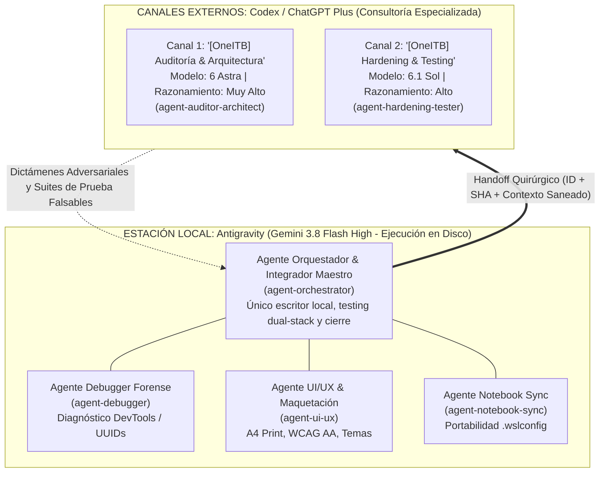

# Marco de Trabajo Multi-Agente — OneITB23 (Release Candidate)

**Fecha de Ratificación:** 2026-11-08
**Estado:** RATIFICADO (Aprobado sin reservas por Canal 1 - 6 Astra en GOB-20261108-07)
**Repositorio:** `https://github.com/fagdiaz/OneITB.git`
**Doctrina Constitucional:** Principio X (Versión 1.7.0)
**Dictamen de Peer Review:** Ratificado formalmente en GOB-20261108-07 (`docs/audit/PEER_REVIEW_MULTI_AGENTE_2026-11-07.md`)

---

## 1. Visión General del Ecosistema

Para maximizar la calidad del código, blindar la seguridad del sistema y aprovechar el 100% de la cuota disponible sin sobrecostos de contexto, OneITB23 opera bajo una **arquitectura multi-agente especializada y asimétrica**:



---

## 2. Catálogo Oficial de Agentes y Skills

Cada agente cuenta con un skill formalmente registrado en `.agents/skills/` que define sus límites, responsabilidades y reglas operativas para **evitar el olvido de rol o deriva cognitiva en el chat**:

| Identificador de Skill | Nombre del Agente | Entorno / Motor | Nivel de Razonamiento | Responsabilidad Principal |
| :--- | :--- | :--- | :--- | :--- |
| **`agent-orchestrator`** | **Orquestador & Integrador** | Antigravity Local<br>`Gemini 3.8 Flash High` | Nativo | Único escritor en disco, Docker, Kestrel, Vite, 258 FE + 234 BE tests, speckit-stabilize y gobernanza Git. |
| **`agent-auditor-architect`** | **Auditor de Seguridad & Arquitectura** | Canal 1 Codex<br>`6 Astra` | **`Muy Alto`** *(o `Alto`)* | Threat modeling, autorización GraphQL (`GAP-AUTH`, `GAP-PRIV`, `GAP-FILE`), Entra ID (PKCE) y decisiones mayores. |
| **`agent-hardening-tester`** | **Hardening & Testing** | Canal 2 Codex<br>`6.1 Sol` | **`Alto`** *(o `Medio`)* | Baterías de pruebas extremas en Vitest/xUnit, concurrencia de WebSockets y sincronización de Apollo Cache. |
| **`agent-debugger`** | **Debugger Forense & Reconciliación** | Antigravity / Codex<br>`Claude Sonnet 4.6` / `6.1 Sol` | **`Alto`** | Diagnóstico en consola DevTools de UUIDs en runtime, solución de ReferenceErrors y reconciliación contra `cv-builder`. |
| **`agent-ui-ux`** | **UI/UX & Maquetación Editorial** | Antigravity / Canal 2<br>`Gemini 3.8 Flash` / `6.1 Sol` | Nativo / Medio | Reglas `@media print` A4, maquetación CSS, contraste WCAG AA, soporte Dark Mode y diagramas SVG/Mermaid. |
| **`agent-notebook-sync`** | **Desarrollo & Sync Notebook** | Terminal Laptop<br>`Gemini` / `Codex` | Nativo / Alto | Configuración de memoria (.wslconfig a 6GB), inspección de estado Git sin pushes automáticos y validaciones pre-flight. |

---

## 3. Matriz de Esfuerzo de Razonamiento (Reasoning Effort)

1. **`Bajo` ➔ TERMINANTEMENTE PROHIBIDO:**
   Nunca degradar el esfuerzo de razonamiento para ahorrar tokens menores; produce análisis superficiales que dejan pasar fallas de código.
2. **`Medio` ➔ PERMITIDO:**
   Para suites de pruebas estándar, transformaciones sintácticas y utilidades donde los contratos de entrada/salida ya están cerrados.
3. **`Alto` ➔ ESTÁNDAR RECOMENDADO:**
   Para análisis de concurrencia, WebSockets, condiciones de carrera en bases de datos y arquitectura de componentes.
4. **`Muy Alto` ➔ MÁXIMA PROFUNDIDAD:**
   Obligatorio para auditorías de seguridad, penetración lógica de GraphQL, verificación de tokens y control de roles en `6 Astra`.
5. **`Ultra` ➔ RESERVADO PARA CRISIS:**
   Solo ante bloqueos circulares o defectos que hayan resistido un intento documentado previo en `Muy Alto`.

*Modelos Prohibidos:* `6 Luna`, `6.1 Terra` y serie `5.6` (veto constitucional ratificado).

---

## 4. Política de Contexto, Tarifas y Cuotas

Tras el dictamen del peer review, se desglosan tres dimensiones independientes:

1. **Tarifa API Directa (Umbral de 272k tokens):**
   En invocaciones directas a las APIs de GPT-6 Astra y 6.1 Sol, cuando la entrada acumulada de una solicitud supera los 272,000 tokens, OpenAI aplica un recargo del 2× en costos de entrada y caché, y de 1.5× en salida.
2. **Suscripción ChatGPT Plus / Codex Work:**
   En entornos de suscripción web/chat, las ventanas de contexto pueden ser de hasta 500k tokens sin recargos tarifarios directos por token. Sin embargo, los canales comparten la asignación semanal de mensajes. Reiniciar un chat no devuelve la cuota semanal ya consumida.
3. **Fidelidad y Continuidad Operativa (Alerta en 200k tokens):**
   El indicador para abrir una nueva sesión no es un número rígido de tokens, sino la **fidelidad de razonamiento**: se debe relevar el chat si el modelo empieza a perder los invariantes del proyecto, olvida el corte de pruebas o contradice la base técnica documentada.

---

## 5. Contrato de Handoff y Protocolo de Entrega

Para evitar divergencias de ramas, falsos estados y filtraciones de información:

1. **Estructura del Despacho:**
   - **Handoff ID:** Identificador unívoco (formato `GOB-YYYYMMDD-NN`).
   - **Rama Activa y SHA:** Rama local real en checkout (`git rev-parse --abbrev-ref HEAD`) y SHA completo (`git rev-parse HEAD`).
   - **Puntero de Spec:** Directorio activo especificado en `.specify/feature.json`.
   - **Material Saneado:** Prohibido enviar tokens JWT reales, cookies, contraseñas, connection strings o volcados de datos sensibles. Solo código, firmas GraphQL y fragmentos necesarios.
2. **Respuesta del Revisor Externo:**
   - Debe referenciar el mismo Handoff ID.
   - Debe estructurarse como propuesta, hipótesis refutada o parche quirúrgico falsable.
3. **Integración Local y Ledger Persistente:**
   - La estación local (Orquestador) es el **único escritor autorizado** en el repositorio.
   - Aplica el parche, corre las suites de regresión completas (258 frontend + 234 backend) y ejecuta `oxlint`.
   - **Idempotencia y Exclusión Mutua Atómica:** Todo despacho aceptado se registra en el ledger persistente en disco (`docs/audit/handoff_ledger.json`) mediante un bloqueo de archivo exclusivo (`.lock`). La operación de consultar, reservar y persistir el ID es estrictamente atómica e indivisible frente a procesos concurrentes. Dos o más instancias que compitan por el mismo ID resultan en exactamente una sola aceptación y el rechazo inmediato del resto (`REJECTED_DUPLICATE`).
   - **Resiliencia ante Corrupción:** Si el archivo histórico del ledger es ilegible o está corrupto, la recepción se bloquea de forma inmediata y el archivo original se conserva intacto para análisis forense, impidiendo sobrescrituras destructivas o vaciados accidentales.
   - **Invariante de Simulaciones:** Las salidas simuladas o mocks en el certificador (`preflight_stabilize.ps1`) tienen prohibido terminantemente otorgar certificación (`Certified=true`). Las simulaciones únicamente pueden producir resultados de prueba informativos en modo inspección (`-Certify` en falso). La certificación oficial de release candidate exige la ejecución real en vivo de los ejecutores xUnit y Vitest.
4. **Autoridad sobre Git:**
   - Queda terminantemente prohibido que cualquier script o agente realice commits o pushes automáticos.
   - El USUARIO conserva el derecho y la autoridad exclusiva para ordenar `git commit` y `git push`.

---

## 6. Protocolo Obligatorio de Notificación en Consola

Al final de **CADA** respuesta que emita cualquier agente del sistema, debe incorporarse el bloque formal de continuidad:

```markdown
---
### 📌 Protocolo de Continuidad Operativa
* **Canal:** `[Local AGY | Canal 1 [OneITB] Auditoría & Arquitectura | Canal 2 [OneITB] Hardening & Testing]`
* **Modelo Sugerido:** `[Gemini 3.8 Flash High | 6 Astra | 6.1 Sol]`
* **Nivel de Razonamiento:** `[Nativo | Medio | Alto | Muy Alto]`
* **Objetivo Inmediato:** `<Descripción concisa de la acción>`
---
```
